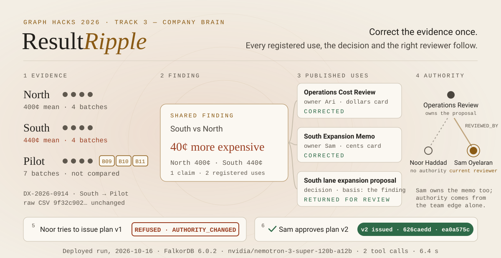
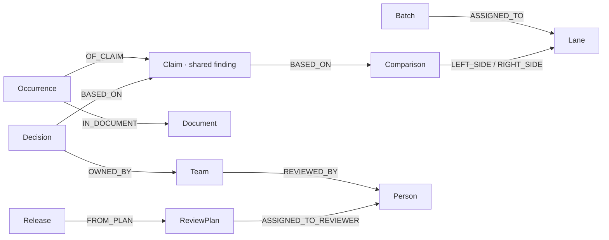

<div align="center">

<picture>
  <source media="(prefers-color-scheme: dark)" srcset="docs/assets/hero-dark.svg">
  <source media="(prefers-color-scheme: light)" srcset="docs/assets/hero-light.svg">
  
</picture>

# ResultRipple

**When the evidence behind a published finding changes, ResultRipple corrects every
registered use, returns the decision that relied on it, and lets only the current
reviewer issue the new editions.**

[](https://52-58-115-104.sslip.io)
[](https://youtu.be/rnEBSMolZmA)
[](https://www.wemakedevs.org/hackathons/falkordb)

Recorded on a local run of the deployed build, with real FalkorDB and NVIDIA inference; edition hashes match production.

[](docs/graph-model.md)
[](docs/agent.md)
[](https://github.com/Asembris/ResultRipple/actions/workflows/ci.yml)
[](https://github.com/Asembris/ResultRipple/actions/workflows/secret-scan.yml)
[](https://github.com/Asembris/ResultRipple/actions/workflows/codeql.yml)
[](LICENSE)

</div>

> **WeMakeDevs × FalkorDB Graph Hacks 2026, Track 3: Company Brain.** A small
> operations-analytics team publishes one cost finding in two reports and relies on it for
> a pending proposal. FalkorDB holds who owns what, which finding each report states,
> what the proposal rests on, and who may review it. Correct the evidence, or move the
> review authority, and the next answer about what the reports say and who may release
> them is read from the changed graph.

## What to look at in 2 minutes

Open **<https://52-58-115-104.sslip.io>**. Without signing in you get the read-only view
of a finished case: every read works and every change is refused by the server. The top
bar steps through the story, and the graph on the left is drawn only from live API
responses.

| Step | Look for |
| --- | --- |
| 1 · Desk | One registered finding, its two published uses, and the proposal that records it as its basis. |
| 2 · Correction | Dispatch note DX-2026-0914 moves B09–B11 from South to Pilot. South goes from $3.60 over 7 batches to $4.40 over 4, and North stays at $4.00. The difference stays 40¢, but its direction reverses. |
| 3 · Investigation | The recorded agent run: 2 model turns, 2 tool calls, 6.4 s, `nvidia/nemotron-3-super-120b-a12b`. The request to *keep South as the cheaper option* is shown as contradicted. |
| 4 · Review | The package the current reviewer approved: both corrected cards, the proposal going from *Proposed* to *Returned for review*, and the content hash. |
| 5 · Authority | The `REVIEWED_BY` edge moved from Noor to Sam. |
| 6 · Fresh approval | Noor's approved plan v1 was refused at release with `AUTHORITY_CHANGED`. Plan v2 has identical bytes and a new reviewer, and Sam approved it. |
| 7 · Editions | Version 2 of both reports, with hashes, the release receipt and Version 1 still readable. |

Then open the receipt it links to,
[`/api/releases/rel-002-44c0bbfc/receipt`](https://52-58-115-104.sslip.io/api/releases/rel-002-44c0bbfc/receipt):
45 independent checks on the bytes that were actually issued.

## The story, as deployed

The live workspace holds this exact run, recorded in [docs/evidence](docs/evidence/README.md):

1. **Version 1 is published.** The Operations Cost Review says *"South costs $0.40 less per
   parcel than North."* The South Expansion Memo says *"South is 40 cents cheaper per parcel
   than North."* The South lane expansion proposal records that finding as its basis.
   Operations Review owns the proposal, and the team's `REVIEWED_BY` edge points to Noor
   Haddad.
2. **Ari Mensah (analyst) confirms dispatch note DX-2026-0914.** One guarded write moves
   B09, B10 and B11 from South to Pilot. The raw CSV and every cost stay byte-identical.
   North stays at 1600/4 = 400¢, and South moves from 2520/7 = 360¢ to 1760/4 = 440¢.
3. **Ari asks the agent:** *"Update the reports, but keep South as the cheaper option in
   the rollout memo."* The model calls `inspect_impact` and then `stage_review`. It reads the
   request as asking to keep the cost claim, which the evidence contradicts, so it stages
   the explicit alternative: correct both registered uses and return the proposal for
   review. The engine renders both candidate editions and assigns the review to Noor,
   because the graph names her.
4. **Noor approves plan v1.** The approval binds to one plan version and one execution
   fingerprint, which includes the current reviewer.
5. **The operator moves review authority from Noor to Sam Oyelaran.** No evidence and no
   candidate byte changes. Only the team's `REVIEWED_BY` edge does.
6. **Noor tries to issue plan v1, and the server refuses with `AUTHORITY_CHANGED`.**
   Release re-reads the graph, finds that Noor no longer holds the review, and writes
   nothing. Plan v1 is recorded as superseded, with `refused_action: RELEASE`.
7. **The review is refreshed for Sam.** Plan v2 is re-staged deterministically, with no
   model call. Its candidate hashes are identical to v1's, and its fingerprint differs.
8. **Sam approves plan v2 and issues Version 2.** The new editions say *"South costs $0.40
   more per parcel than North"* and *"South is 40 cents more expensive per parcel than
   North."* The proposal is *returned for review*. Version 1 stays readable as superseded.

Sam owns the memo and also becomes its reviewer. That is allowed only because the team's
`REVIEWED_BY` edge now names Sam: document ownership grants no review authority, and
before the change Sam could not approve. The product does not enforce separation of
duties (see [Limitations](#limitations)).

Sign in yourself and try the refusals. Ari's passcode does not authenticate anyone as
Noor. A reviewer who is not the current one is refused. Telling the agent it already has
permission changes nothing, because no tool exists through which it could act on that.

## The graph is the authority

Change an edge and the system changes who may release and what the report says.
Memberships (`Batch-[:ASSIGNED_TO]->Lane`), the finding's binding to its comparison, its
registered uses, the decision's recorded basis and the team's current reviewer are all
graph edges. Every impact, scope and authority answer is a fresh parameterized query
against FalkorDB, with no cached list and no reviewer name in application code. With
FalkorDB unavailable, new corrections, reviews and releases stop.

Two precise points:

- **The publication scope comes from the graph's document inventory**, meaning every
  registered occurrence in every document, never from a list supplied by a caller. The
  case's impact traversal, from the corrected lanes through comparison, claim and
  occurrence to each document, is a **cross-check**. Staging, refresh and release hold
  with `IMPACT_SCOPE_MISMATCH` unless both name exactly the same occurrences, and an
  empty traversal is a hold, never "no dependencies".
- **The decision is a fixed workspace primitive.** Its status changes at release only
  through its recorded `(Decision)-[:BASED_ON]->(Claim)` path to a claim inside the
  released scope.



The full schema, cardinality holds and FalkorDB 6.0.2 notes are in
[docs/graph-model.md](docs/graph-model.md). The fixed, parameterized Cypher, including
every guarded write, is in [docs/queries.md](docs/queries.md).

## The agent

The agent reads the request into a typed intent and chooses to act or to ask; the engine
owns every figure. One NVIDIA-hosted model (`nvidia/nemotron-3-super-120b-a12b`) gets
four typed tools: `get_case_context`, `inspect_impact`, `stage_review` and
`request_clarification`. It decides what the request asked to keep and which permitted
disposition to propose, or it asks one focused question when the request is ambiguous.
It never computes a number, writes a card sentence, narrows the scope, approves or
releases. Its principal is not a `Person` in the graph, so every authority check fails for
it by construction.

Each job is bounded to 4 model turns, 6 tool calls and 25 seconds, and each model call to
4096 completion tokens.
The deployed run used 2 turns, 2 tool calls, 6,017 tokens and 6.4 s. With no credential
configured, the app offers a labelled manual workflow that runs the same deterministic
staging, and does not pass it off as an agent run. Details are in
[docs/agent.md](docs/agent.md).

## Evidence

[docs/evidence](docs/evidence/README.md) holds byte copies of what the live API served for
the run above: the agent job, both plans, both release receipts, all four issued editions
with a `SHA256SUMS` file, and signed-out screenshots of every step.

| | Release 1 | Release 2 |
| --- | --- | --- |
| Operations Cost Review | `5a670a69…cc26` | `626caedd…0468` |
| South Expansion Memo | `93c8b9db…5a9c` | `ea0a575c…33e0` |
| Raw CSV `backend/data/batches.csv` | `9f32c902…b6aa` | `9f32c902…b6aa` |
| Issued by | Noor (demo setup) | Sam, after Noor's `AUTHORITY_CHANGED` refusal |

## How correctness is enforced

- **Arithmetic** uses integer cents and exact `Fraction` means. Rounding happens only for
  display, under a pinned half-up rule, and direction is decided on the exact signed
  difference.
- **The factual grammar is finite:** lower cost, higher cost, equal mean cost, or an
  explicit withheld comparison with a reason. A card is rendered whole from a closed
  template, and no free-text span is ever patched. A withheld comparison is held at staging
  (`RESULT_WITHHELD`).
- **Scope is enumerated by the engine** from the document-rooted inventory and must equal
  the impact traversal. Every card must be bound to the comparison it states, and a
  decision block must have a recorded basis placed beside it. Otherwise nothing is
  rendered.
- **Candidate-content identity** covers measurements, memberships, the evidence binding,
  every source block and occurrence, the typed disposition, the bound intent and the
  template version. **Execution identity** adds the candidate hashes, the current reviewer,
  the context revision, the plan version and the prior release. A reviewer change
  therefore preserves the bytes and invalidates the approval.
- **A stale plan is retired, not stranded.** `STALE_PLAN`, `STALE_CONTEXT` or
  `VERIFICATION_FAILED` marks it invalidated with its reason and reopens the case for a
  new version. An `AUTHORITY_CHANGED` refusal is recorded on the plan, and the refreshed
  version supersedes it. An old approval never carries over.
- **Guarded mutations write everything or nothing.** Every existence and cardinality check
  precedes the first write clause.
- **Sessions need a credential.** Passcodes are held server-side, compared in constant
  time, never served to the browser, and resolved to a role in the graph. Sessions are
  signed, expiring, `HttpOnly` cookies.
- **An independent verifier** (`backend/app/verify_artifacts.py`) re-reads the immutable
  CSV and the membership snapshot, re-derives the arithmetic, re-states the expected
  sentences from its own copy of the grammar, and parses the actual generated bytes. It
  imports nothing from the engine, the renderer or the templates.

## The frozen dataset

There are 15 synthetic batches of equal analytical weight, with integer cents per parcel,
in `backend/data/batches.csv`:

| Batches | Initial lane | Cost (cents) | Corrected lane |
| --- | --- | --- | --- |
| B01–B04 | North | 380, 400, 420, 400 | North |
| B05–B08 | South | 420, 440, 460, 440 | South |
| B09–B11 | South | 240, 250, 270 | **Pilot** |
| B12–B15 | Pilot | 250, 260, 240, 250 | Pilot |

North minus South moves from **+40 to −40 cents**. The CSV bytes and all 15 costs are
untouched; exactly three effective membership relationships change. The four-batch
minimum is a declared demo policy, not a significance test, and this is a descriptive
comparison, not a causal savings estimate.

## Quickstart

Requirements: Docker, Python 3.12, Node.js 20+.

```bash
cp .env.example .env
docker compose up -d
```

```bash
cd backend
python -m venv .venv
.venv/Scripts/python -m pip install -r requirements-dev.txt   # Linux/macOS: .venv/bin/python
.venv/Scripts/python -m scripts.seed_demo --reset
.venv/Scripts/python -m uvicorn app.main:app --reload --port 8000
```

```bash
cd frontend
npm install
npm run dev
```

Open <http://localhost:5173>. The dev server proxies `/api` to the backend, so the
session cookie stays first-party.

- **Seeding** writes only primitive facts: the 15-batch dataset, three lanes, one
  comparison, one shared finding registered in two reports, one proposal and its
  reviewer, and the dispatch correction note. It then issues Version 1 by running the real
  staging, approval, verification and release path once, labelled demo setup. No
  corrected file, affected-document list or reviewer answer is seeded.
- **Authoring start.** `--fresh` writes the same primitives into an empty graph, with no
  finding, occurrence, decision basis or edition. The analyst then registers the finding,
  places it in both reports and records the basis through the UI, and issues the first
  edition through the same release path. It refuses any graph that already holds nodes:
  `FALKORDB_GRAPH=rr_authoring .venv/Scripts/python -m scripts.seed_demo --fresh`.
- **Passcodes.** With `DEMO_PASSCODES` unset, the API generates throwaway passcodes for
  this process and logs them at startup. Copy them from that log to sign in. They are
  never committed, shipped in the frontend bundle or returned by an endpoint.
- **The agent** needs `NVIDIA_API_KEY`. The repository-root `.env` and `backend/.env` are
  both loaded, `backend/.env` wins over the root file, and real environment variables win
  over both. Without a key, `GET /ready` reports `agent.configured: false`, agent runs are
  refused with `MODEL_NOT_CONFIGURED`, and the app offers the labelled manual workflow.

<details>
<summary>Environment variables</summary>

| Variable | Default | Meaning |
| --- | --- | --- |
| `FALKORDB_HOST` | `127.0.0.1` | FalkorDB host the API connects to |
| `FALKORDB_PORT` | `6379` | Published FalkorDB port (compose and API) |
| `FALKORDB_GRAPH` | `resultripple` | Graph name the API selects |
| `FALKORDB_TIMEOUT_SECONDS` | `2.0` | Connect and socket timeout for graph calls |
| `API_HOST` / `API_PORT` | `127.0.0.1` / `8000` | Uvicorn bind address |
| `ARTIFACT_ROOT` | `backend/runtime/artifacts` | Staged candidates and immutable issued editions |
| `DATASET_CSV_PATH` | `backend/data/batches.csv` | Immutable measurements |
| `APP_ENV` | `development` | `development` or `test` allow generated local credentials; anything else is a deployment |
| `SESSION_SECRET` | development placeholder | Signs the session cookie. A deployment must set at least 32 characters |
| `DEMO_PASSCODES` | unset | `person-id=passcode` pairs gating sign-in. Generated and logged locally; required in a deployment |
| `PUBLIC_ORIGIN` | unset | The deployed site's own `https://` origin. Required in a deployment; the only origin allowed to change state there |
| `VITE_API_BASE_URL` | `/api` | API base used by the frontend |
| `NVIDIA_API_KEY` | unset | The agent's credential. Environment only; never logged, returned or written into an artifact |
| `NVIDIA_API_BASE_URL` | `https://integrate.api.nvidia.com/v1` | OpenAI-compatible endpoint |
| `NVIDIA_MODEL` | `nvidia/nemotron-3-super-120b-a12b` | The one frozen model |
| `NVIDIA_REASONING` | `false` | Hosted reasoning control. See [docs/agent.md](docs/agent.md) |
| `AGENT_DEADLINE_SECONDS` | `25` | Request through persisted candidates |
| `AGENT_MAX_MODEL_TURNS` · `AGENT_MAX_TOOL_CALLS` | `4` · `6` | Per-job ceilings |
| `AGENT_MAX_COMPLETION_TOKENS` | `4096` | Per model call, including reported reasoning |
| `AGENT_MAX_CONCURRENT_JOBS` | `2` | Process-wide bound; one worker, one lock |

If port 8000 is taken, start Uvicorn elsewhere and point the dev proxy at it with
`API_PROXY_TARGET=http://127.0.0.1:8010 npm run dev`.

</details>

<details>
<summary>Endpoints</summary>

| Endpoint | Behaviour |
| --- | --- |
| `GET /health` | Liveness only. Touches no external dependency. |
| `GET /ready` | Runs a real parameterized FalkorDB query. `200` when the graph answers, `503` with a typed `error_code` when it does not. |
| `POST /auth/demo-session` · `POST /auth/sign-out` | Sign in a provisioned demo identity against its server-side passcode, or drop the session. Capability is resolved from the graph. |
| `GET /workspace` | Current evidence, live comparison, registered scope, per-occurrence freshness, decision and current reviewer, cases and releases. |
| `GET /comparisons/{id}` | What the analyst confirms before registering a finding, computed live. |
| `POST /findings` | Analyst only. Registers the displayed comparison as an approved finding. No free prose. |
| `POST /documents/{id}/linked-findings` | Analyst only. Places the finding in a document in that layout's approved style and updates its block inventory in the same guarded write. |
| `POST /decisions/{id}/basis` | Analyst only. Records `Decision -[BASED_ON]-> Claim` once the finding sits in the decision's document. |
| `POST /corrections/{case_id}/apply` | Analyst confirms the dispatch source; one guarded mutation moves exactly the recorded batches. |
| `POST /cases/{case_id}/agent-runs` · `GET /jobs/{job_id}` · `GET /cases/{case_id}/agent-runs` | Start one bounded agent job from the analyst's own words, and read its real status, tool events, usage and timing. |
| `POST /cases/{case_id}/stage-review` | The manual fallback: real candidates and one review plan over the complete registered scope. |
| `POST /cases/{case_id}/refresh-review` | Deterministic re-staging after an authorized reviewer change. No inference, no transferred approval. |
| `GET /plans/{id}` · `/plans/{id}/candidates/{document_id}` | Plan fingerprint and scope; the actual staged bytes. |
| `POST /plans/{id}/approve` · `/reject` | Current assigned reviewer only, against one exact version and fingerprint. |
| `POST /plans/{id}/release` | Re-reads context, regenerates, verifies and commits the whole package. Idempotent per `operation_id`. |
| `GET /editions/{release_id}/{document_id}` · `GET /releases/{id}/receipt` | Serves only an allowlisted path recorded in a committed release, and its receipt. |
| `POST /demo/reviewer-assignment` | Guarded synthetic rota change. Operator only. |
| `POST /demo/reset` | Operator only. `demo_setup` or `authoring_start`. Refuses while a write holds the lock or an agent run is unfinished. |

Refusals carry a stable code, such as `NOT_AUTHORIZED`, `AUTHORITY_CHANGED`,
`STALE_PLAN`, `IMPACT_SCOPE_MISMATCH`, `MISSING_PROVENANCE`, `CANDIDATE_MISMATCH`,
`VERIFICATION_FAILED` or `MODEL_NOT_CONFIGURED`, plus the witness the UI needs to explain
it. In a deployment, every state-changing request must name the site's own origin.

</details>

## Deployment

One host runs [compose.prod.yaml](compose.prod.yaml) with FalkorDB, the API and Caddy,
and nothing else.

| Service | Exposure | State |
| --- | --- | --- |
| `falkordb` (`falkordb/falkordb:6.0.2`) | Internal Docker network only | Named volume `falkordb-data`, AOF with `appendfsync always` |
| `api` ([backend/Dockerfile](backend/Dockerfile)) | Private networks, reached through Caddy | Named volume `api-runtime` for staged candidates and issued editions |
| `caddy` ([frontend/Dockerfile](frontend/Dockerfile)) | Ports 80 and 443 | Named volumes for certificates and Caddy state |

Caddy serves the built frontend at `/`, proxies `/api/*` to the API, and obtains the
certificate for `SITE_HOST`. The API runs one Uvicorn worker with `APP_ENV=production`.
It refuses to start without a `SESSION_SECRET` of at least 32 characters,
`DEMO_PASSCODES` and an `https://` `PUBLIC_ORIGIN`. The cookie is then
`Secure; HttpOnly; SameSite=Lax`. Secrets live in a `chmod 600` env file on the server and
never in the repository, the images or a log.

```bash
docker compose --env-file /opt/resultripple/.env -f compose.prod.yaml up -d --build
docker compose --env-file /opt/resultripple/.env -f compose.prod.yaml exec api python -m scripts.seed_demo
```

After that the operator resets the workspace through `POST /api/demo/reset`. Persistence
check, which confirms the editions survive a container restart:

```bash
docker compose exec falkordb redis-cli CONFIG GET appendonly appendfsync
```

## Tests

```bash
cd backend && .venv/Scripts/python -m pytest -q
```

```bash
cd frontend && npm run typecheck && npm run test && npm run build
```

CI runs five jobs on every pull request and push to `main`:

- backend `pytest` against a **real FalkorDB**, with nothing mocking the graph;
- frontend typecheck, unit tests and build;
- the production image builds with the Compose and Caddy configuration checked;
- two Playwright suites against the real API, graph and rendered editions, one on the
  demo-setup seed and one on a fresh authoring workspace.

The backend suite covers:

- the hand-derived arithmetic, and the immutable CSV hash with exactly three changed
  memberships;
- complete occurrence coverage that a caller cannot narrow;
- missing and duplicate provenance, and reviewer enforcement;
- stale approval, an authority change that refuses a previously valid approval, and
  idempotent release;
- refused writes that leave the graph byte-identical;
- an independent verifier that must reject reversed directions, changed magnitudes,
  edited narrative, a missing second report, and bytes that differ from the approved
  hashes.

`tests/test_agent_live.py` makes real NVIDIA calls for the semantic scenarios and skips
without a credential. CI has no NVIDIA credential and says so in its log.

## Limitations

- **The evidence run was a script.** The run in [docs/evidence](docs/evidence/README.md)
  is a script that drove the human steps through the API: sign-ins, correction,
  approvals, the reviewer change and releases. The agent call in the middle was real. The
  demo video shows the same story clicked through at normal speed.
- **No separation of duties.** In the demo, Sam is the new reviewer and also owns the
  memo whose correction Sam approves. Authority comes only from the team's `REVIEWED_BY`
  edge.
- **Only registered blocks are checked.** That means registered finding cards and the
  typed decision-status block in named report versions; narrative outside them is not
  assessed. Approved provenance can still be factually wrong: human approval and template
  correctness do not establish real-world truth. A hash proves which bytes were issued,
  not that the dispatch note was right. Old downloads and external copies are not
  touched.
- **Demo passcodes are a sandbox gate**, not enterprise authentication. There is no
  account system, rotation, multi-factor step or rate limit on sign-in, agent runs, resets
  or reads. A determined caller can exhaust the agent budget of this single small host.
- **The read-only view shows the whole case.** Anyone can read plans, jobs, receipts and
  the analyst's raw request; all data is fictional.
- **Reset is API-only.** There is no reset control in the interface.
- **No editions while FalkorDB is down.** An edition is served only through the path and
  hash its release recorded in the graph, so reads return `503` until FalkorDB answers.
  The files stay intact on the volume.
- **No reconciliation of direct writes.** Memberships moved by a graph write made outside
  the API are published as the effective membership they now have.
- **The commit is not a distributed transaction.** It is a local filesystem protocol plus
  one guarded graph write. The API runs one worker because the mutation lock is
  in-process.
- **The model's interpretation is fallible.** A typed goal is the model's reading of a
  request, which is why the raw request stays beside it and a human must acknowledge any
  alternative. Its choices and latency vary on a shared endpoint.

All organizational data in this project is fictional demo setup.

## Demo video

[Watch the demo on YouTube](https://youtu.be/rnEBSMolZmA) (107 s)

## Development assistance

Development assistance: ChatGPT was used for product design discussion, planning and code review; Claude Code was used for implementation, testing and deployment operations; independent audits were run in separate Claude sessions. Architecture, verification and submission decisions were reviewed and made by the project author. The demo voiceover was generated with ElevenLabs.

## License

[MIT](LICENSE)
